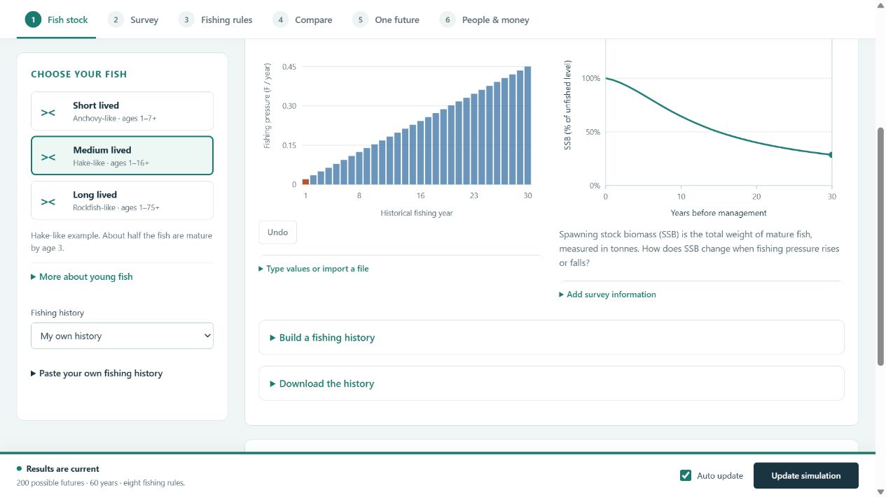
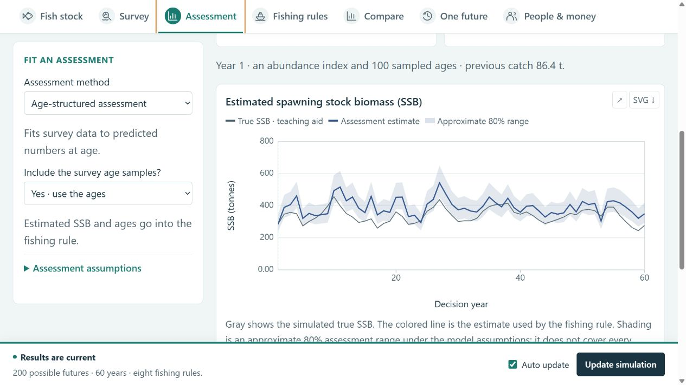
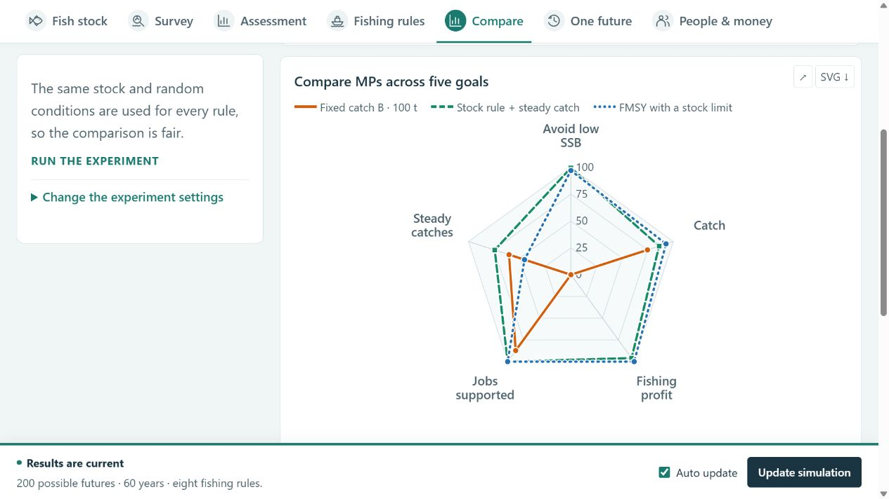
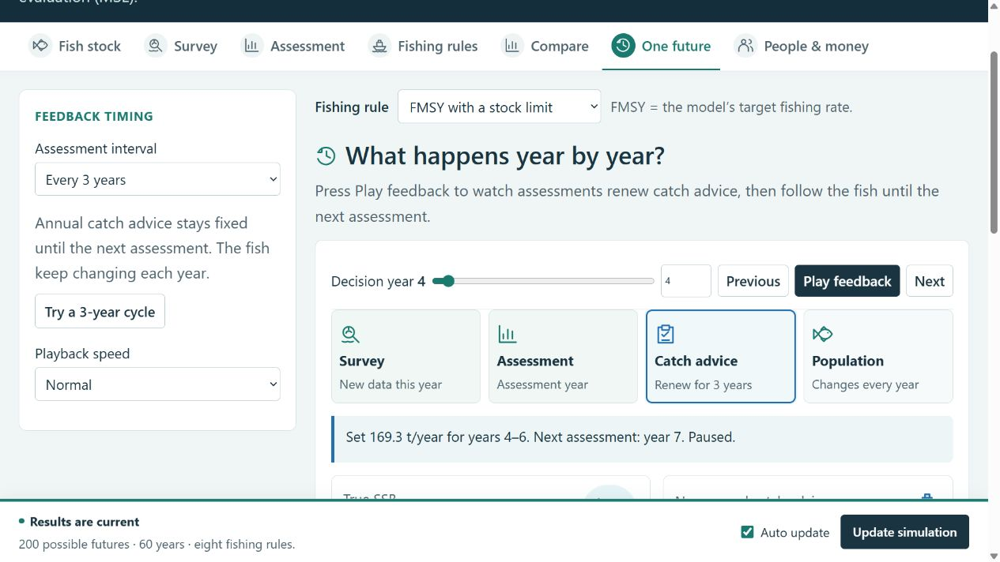
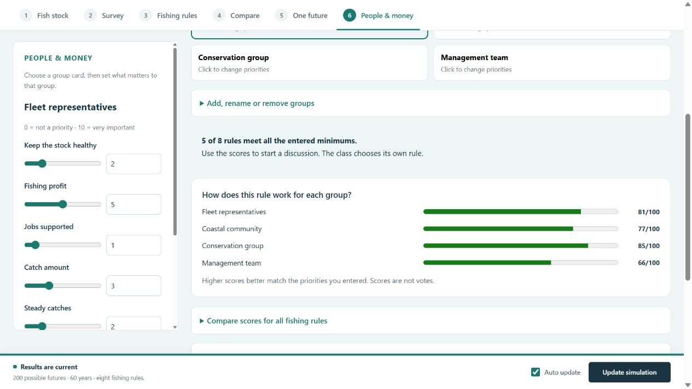

# Fisheries MSE Lab

[**Open the classroom lab**](https://lichengxue.github.io/fisheries-mse-lab/) · [Source code](https://github.com/lichengxue/fisheries-mse-lab)

Choose a fish, try fishing rules, and see what could happen. This browser lab introduces **management strategy evaluation (MSE)**: testing decisions in a simulated fishery before applying them in real life.

**No account, installation or internet connection is needed for the downloaded lab.** The public website works in a normal browser.



**Spawning stock biomass (SSB)** is the total weight of mature fish, measured in tonnes.

## Start here

1. **Fish stock:** choose short-, medium- or long-lived fish and a fishing history. Drag a bar to change fishing pressure.
2. **Survey:** choose an abundance index, age samples, or both. Change index noise and the number of fish aged.
3. **Assessment:** choose the assessment interval (default: every year), fit an age-structured model, and inspect estimated SSB. Try leaving ages out of the fit.
4. **Fishing rules:** choose a rule and adjust its settings. The page shows the controls relevant to that rule.
5. **Compare:** use a radar to compare up to three MPs across five goals, or choose two goals for a trade-off plot. See the original values and change the shared class targets when needed.
6. **One future:** press **Play feedback** to watch surveys, assessments, catch advice and population change. **Try a 3-year cycle** shows advice held in years 1–3, then renewed in year 4.
7. **People & money:** explore income, jobs and different groups' priorities.

**Text size:** the default labels and plot text are larger. Choose **Text size → Larger** at the top for extra-large text; the browser remembers your choice. Fish, boat, catch, income and group symbols appear beside their text labels.

The question at the top of each page is the starting point. Extra settings, tables and equations start closed; open them when needed. On a smaller screen, use **Edit … settings** to reach the controls.

**Save / Load scenario** keeps your settings and discussion rounds. Plot buttons enlarge or download a figure. CSVs and workshop reports are inside the relevant expandable panels.

The **Assessment** step shows estimated SSB and optional observed-versus-fitted plots. Extra assumptions and fitting details start closed. The assessment interval is separate from the survey interval.



The **Compare** screen shows the trade-offs among management procedures (MPs). Radar axes point outward for better performance on a shared 0–100 scale; changing the selected MPs does not change that scale. The two-goal view keeps catch, profit, jobs, risk and catch change in their original units. Polygon area does not choose a winner.



## Watch the feedback cycle

Choose **One future → Assessment interval**, or set the same control on **Assessment**. Assessments begin in year 1 and repeat every 1–10 years. The default is annual assessment; older saved scenarios keep this behavior.

**Play feedback** highlights each step. At an assessment, stored survey data update the estimate and the rule sets annual catch advice for the coming period. Between assessments, the population and its prediction change each year while advice stays fixed. Actual catch can differ from advice. Pause, change playback speed, or click a year in the period strip. Open **See this year's numbers** to download the full future.



## People and money

Change price, fishing costs and small-vessel catch share. Compare profit and estimated jobs. In **Stakeholder discussion**, choose a group and set its priorities, compare scores, then record the class's own votes and decision. Scores are discussion aids, not votes.

Prices, costs and job estimates are classroom assumptions. Economic calculations use the simulated catches and fishing pressure without changing stock dynamics or fishing behavior.



[Instructor guide](docs/INSTRUCTOR_GUIDE.txt) · [Economics and discussion exercise](docs/ECONOMICS_AND_WORKSHOP.txt) · [Model equations](docs/MODEL.md)

## Download for offline use

Choose **Code → Download ZIP**, extract the folder, and open **index.html**. No setup is required. If your browser restricts local HTML features, use the public website or the optional local server below.

<details>
<summary>Model details</summary>

The operating model tracks fish by age, with short-lived anchovy-like, medium-lived hake-like and long-lived rockfish-like presets. These are illustrative combinations, not parameters fitted to real stocks. Historical annual fishing pressure F drives the population; Beverton–Holt stock–recruitment supplies young fish. The final historical population starts each future.

Future choices include three fixed catches, a fixed share of estimated SSB, stock-responsive catch rules, and FMSY fishing targets. A survey can provide a relative biomass index and/or multinomial age samples, with separate index noise and effective age-sample size. The default sequential age-structured assessment fits numbers at age to these data and predicts forward using past reported catch. Assumed q, natural mortality and model flexibility are editable. Two index shortcuts are available for comparison. All eight rules share random conditions for fair comparisons.

The assessment is a simplified sequential fit, not a whole-history stock assessment. Its approximate 80% SSB range is conditional on assumed biology and q; it omits several sources of uncertainty. The model never receives true abundance or true F. [Full assessment equations and limitations](docs/MODEL.md).

FMSY, MSY and SSB reference points are calculated from the assumed biology. Stock and catch plots include median and 10th–90th percentile outcomes. Optional tables expose risk, catch variation, reference points, economic uncertainty and objective scores. The 48 checks cover population dynamics, historical forcing, estimation, management rules, reproducibility, accounting, scoring and shared limits.

</details>

<details>
<summary>Run locally or edit the source</summary>

Install Node.js 20 or newer. No third-party packages are required.

```sh
npm test
npm run build
npm start
```

Open `http://127.0.0.1:8000`. Set `PORT` to choose another port. Rebuild after editing source; `index.html` is generated and checked in for offline use. `dist/` is generated for deployment and ignored by Git.

| File | Purpose |
| --- | --- |
| `src/model.js` | Age-based population, history, surveys, estimation and fishing rules |
| `src/tradeoffs.js`, `src/tradeoff-ui.js`, `src/tradeoff.css` | Shared objective scales, radar and selectable two-goal MP comparisons |
| `src/feedback.js`, `src/feedback.css` | Staged assessment/advice/population playback and one-future export |
| `src/assessment-ui.js`, `src/assessment.css` | Separate survey and assessment screens, data-fit plots and joint data export |
| `src/app.js` | Simulation worker, base plots and exports |
| `src/ui.js`, `src/ui.css` | Guided navigation and interactive controls |
| `src/visuals.js`, `src/readability.css` | Shared fisheries symbols, larger typography and remembered text-size preference |
| `src/clarity.js`, `src/clarity.css` | Short teaching path, plain labels and optional detail |
| `src/economics.js` | Economic accounting and stakeholder scores |
| `src/workshop.js`, `src/workshop.css` | Income, jobs and classroom discussion |
| `src/ui-helpers.js` | Fishing-history builder and CSV parsing |
| `src/page.html` | Page template and detailed explanations |
| `tests/` | 48 model and consistency checks |
| `scripts/build.cjs` | Packs the offline page and Pages artifact |

</details>

<details>
<summary>Publish with GitHub Pages</summary>

Upload or push this folder, including `.github/workflows/pages.yml`. In **Settings → Pages**, choose **GitHub Actions** as the source. The workflow tests, builds and deploys on pushes to `main`; it can also be run from **Actions**. It uses GitHub's built-in token and no custom secrets.

See [GitHub Pages setup](https://docs.github.com/en/pages/getting-started-with-github-pages/using-custom-workflows-with-github-pages).

</details>
