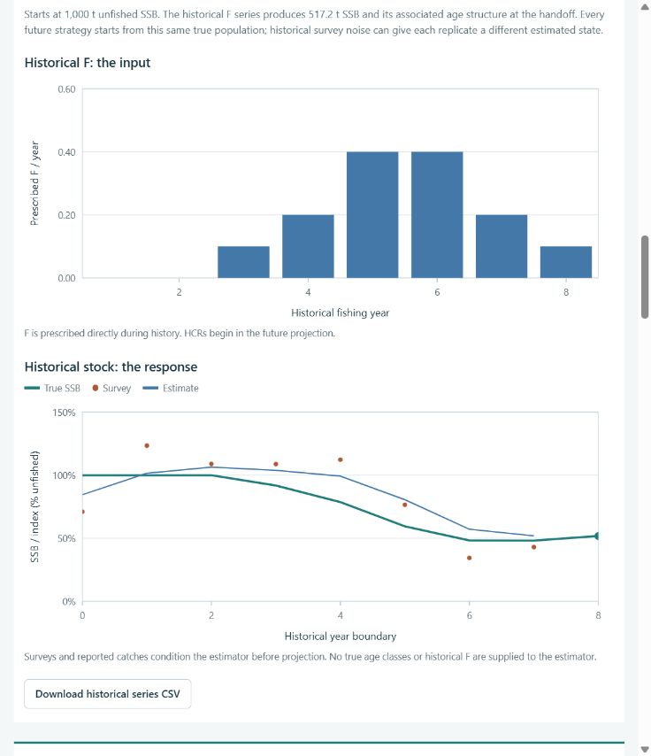

# Fisheries MSE Lab

A browser GUI for teaching age-structured fisheries **management strategy evaluation (MSE)**. Historical fishing mortality drives the population, Beverton–Holt recruitment supplies new fish, and future management procedures are compared under imperfect information.

**No GPT, OpenAI account, API key, Python, R, or package installation is needed to use the GUI.** The model runs entirely in the browser. This repository includes a ready-to-open `index.html` and an automated GitHub Pages workflow.



## Play with the GUI

1. Download this repository with **Code → Download ZIP** and extract it.
2. Double-click **index.html** to open it in a modern browser.
3. Edit the historical F series or load an example, adjust the survey and management settings, and click **Run history + 8 strategies**.

The offline GUI works without an internet connection. Browser settings remember the latest completed scenario. Source links in the explanatory text require internet access when opened.

If your browser restricts local HTML features, use the local server below or the published GitHub Pages site.

## Population and management modules

| Module | Choices and behavior |
| --- | --- |
| Life history | Short-lived anchovy-like, medium-lived hake-like, or long-lived rockfish-like |
| Historical population | Paste 1–150 annual F values; survival, catch, aging and expected Beverton–Holt recruitment generate the population history |
| Projection start | Uses the final historical numbers at age and SSB directly |
| Survey | Adjustable noise CV, bias and annual / biennial / triennial sampling |
| Estimation | Latest survey, up-to-three-survey mean, or a simple age-structured filter; conditioned using historical surveys and catches |
| Future HCRs | Three independent fixed catches, proportional catch, catch ramp, smoothed catch ramp, constant F target, or F-based ramp |
| Reference points | Deterministic FMSY, MSY and SSBMSY calculated from assumed biology |
| Outputs | Historical F and stock response, biomass/catch uncertainty bands, risk, catch variation, age composition, F, recruitment and CSV exports |

For a first experiment, paste this historical F series (oldest year first):

```text
0, 0, 0.1, 0.2, 0.4, 0.4, 0.2, 0.1
```

Compare its population response with an unfished history. Then compare future catch quotas or change the FMSY multiplier. Keep the seed fixed for comparisons.

The [instructor guide](docs/INSTRUCTOR_GUIDE.txt) contains a classroom exercise and detailed output definitions. [Model equations and timing](docs/MODEL.md) explain how historical F, recruitment and future decisions connect.

## Put the GUI on GitHub Pages

The included workflow tests the model, builds the static GUI and deploys it from `main`.

1. Create a GitHub repository and upload or push this folder, including `.github/workflows/pages.yml`.
2. Open **Settings → Pages**. Under **Build and deployment**, select **GitHub Actions** as the source.
3. Open **Actions → Test and deploy MSE GUI → Run workflow**. Later pushes to `main` deploy automatically.
4. Open the published URL shown by the deployment. Students can use that website in a normal browser.

GitHub Pages is available for public repositories on GitHub Free; private-repository availability depends on the GitHub plan. A private repository does not automatically make a Pages site private. See [GitHub Pages documentation](https://docs.github.com/en/pages/getting-started-with-github-pages/what-is-github-pages) and [custom workflow setup](https://docs.github.com/en/pages/getting-started-with-github-pages/using-custom-workflows-with-github-pages).

Only the static GUI is uploaded as the Pages artifact. The deployment uses GitHub's built-in workflow token, with no custom API keys or repository secrets.

## Edit or run as a developer

Install Node.js 20 or newer. No third-party runtime or development packages are required, so `npm install` is unnecessary.

```sh
npm test
npm run build
npm start
```

Open `http://127.0.0.1:8000`. The optional server listens only on your own computer. Set `PORT` to choose a different port.

The equivalent commands without npm are:

```sh
node --test tests/model.test.cjs
node scripts/build.cjs
node scripts/serve.cjs
```

After source edits, rebuild before opening the offline `index.html`. Pages always builds fresh source in its workflow.

| File | Edit it to change |
| --- | --- |
| `src/model.js` | Population dynamics, presets, BH parameters, estimator, reference points or HCRs |
| `src/app.js` | GUI controls, SVG plots, worker execution or CSV exports |
| `src/page.html` | Layout, wording, equations or source links |
| `scripts/build.cjs` | Standalone HTML packaging |
| `tests/model.test.cjs` | Scientific and stochastic consistency checks |
| `.github/workflows/pages.yml` | Continuous checks and Pages deployment |

`index.html` is a generated file checked in so users can open the app immediately. `dist/` is generated for deployment and ignored by Git.

## Scientific scope

This is a teaching simulator with illustrative parameter combinations, not a calibrated stock assessment. All stocks have unfished SSB of 1,000 tonnes. Historical recruitment uses the Beverton–Holt mean; the recruitment-CV control applies to future projections. The historical F series is applied directly to the true population. Future F targets are converted to catch advice using estimated abundance, so realized F can differ from target F.

The 21 model checks cover age-group survival, recruitment, catch calculations, reference-point maximization, historical forcing, estimator conditioning, historical-to-future timing, common random numbers and HCR behavior. The browser GUI also contains expandable equations and assumptions.

See the primary references linked inside the app: [IOTC age-based equations](https://iotc.org/sites/default/files/documents/2023/09/IOTC-2023-WGFAD05-04.pdf), [FAO reference points](https://www.fao.org/4/v8400e/V8400E02.HTM), and [openMSE recruitment](https://openmse.com/object-stock/3-recruitment-parameters/).
